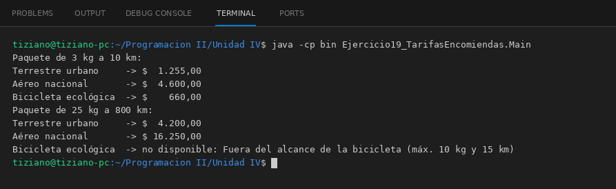

# MetodoEnvio

Programación II - Unidad 4 - Ejercicio 19

## Consigna
Presupuestar el despacho de una encomienda según el medio de entrega.

## Lógica
- Clase abstracta `MetodoEnvio` (nombre, tarifaBase) con `double calcularTarifa(pesoKg, distanciaKm)`; valida peso y distancia positivos.
- `EnvioTerrestre`, `EnvioAereo` y `EnvioEcologico` aplican factores propios; la bicicleta rechaza paquetes de más de 10 kg o 15 km con `IllegalArgumentException`.
- `SistemaTarifario` presupuesta con cualquier `MetodoEnvio` y compara varias opciones, informando las no disponibles.
- `Main`: un paquete liviano cercano y otro pesado y lejano.

## Ejecución

